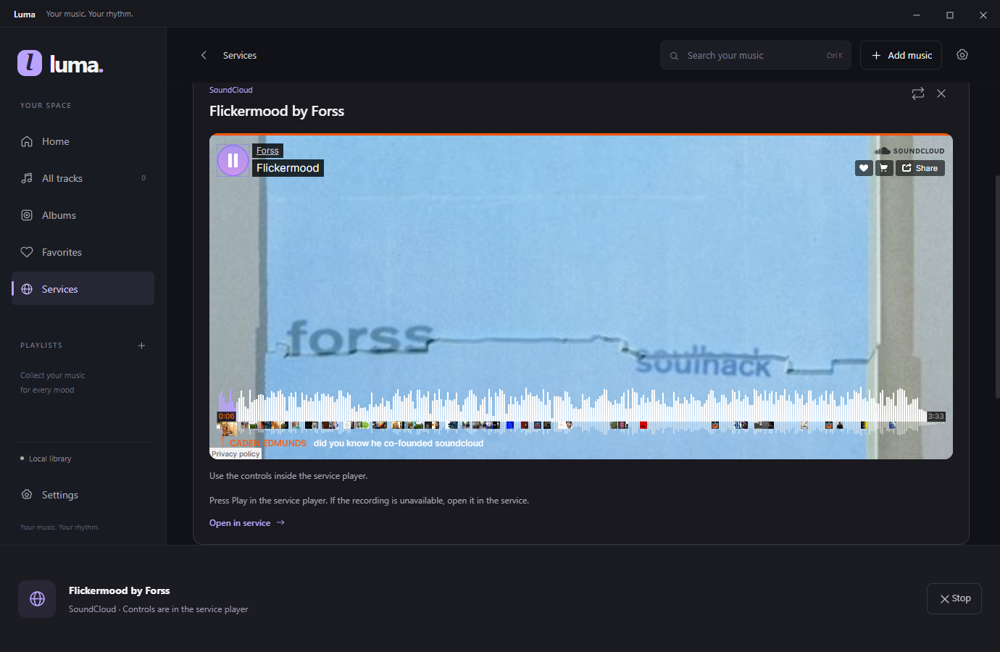
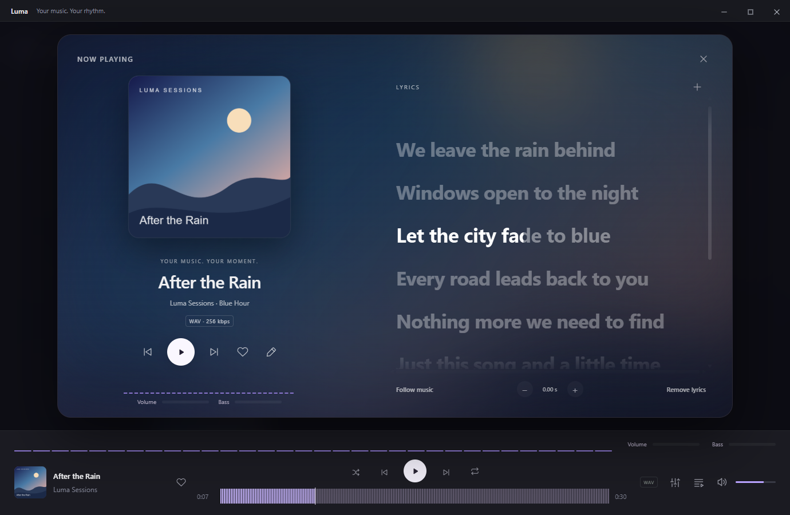
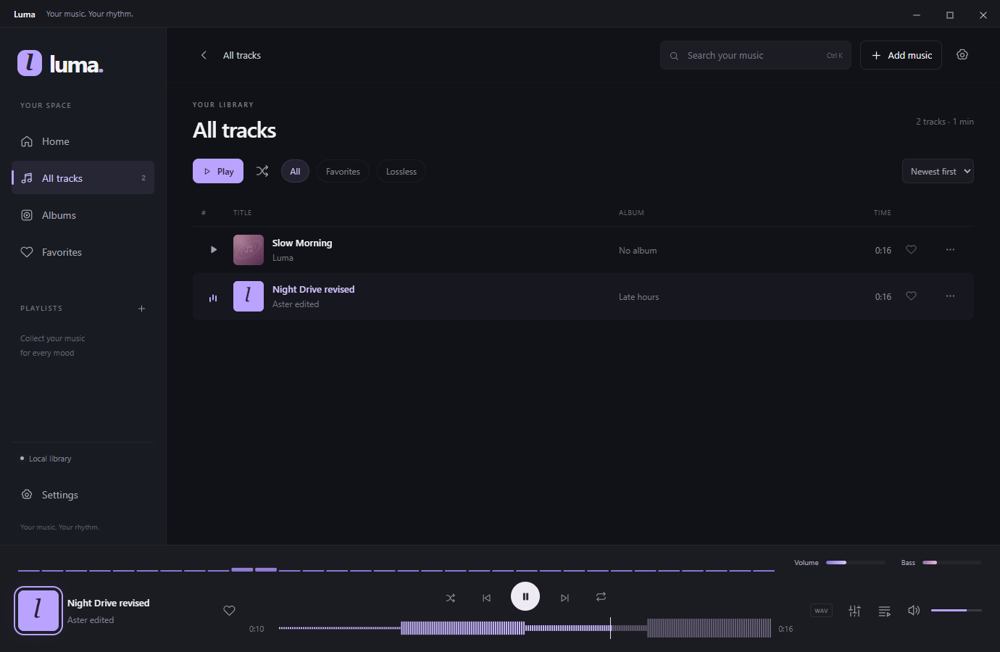
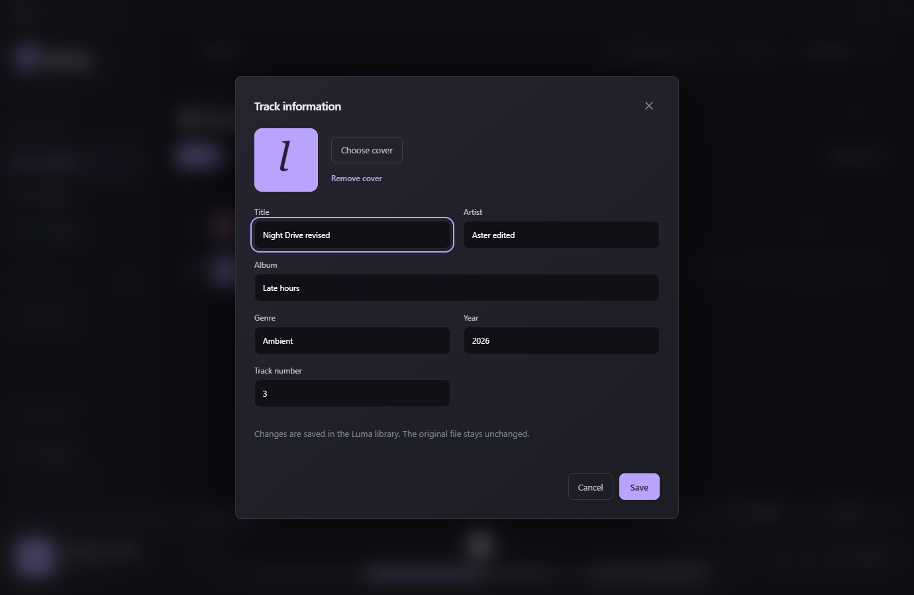

# Luma

A free, open-source local music player for Windows, with optional Spotify and SoundCloud players. Import your own files, organize playlists and albums, and enjoy synchronized local lyrics and cover backgrounds. Edit track information, tune the equalizer, use crossfades, waveforms and real audio visualization, and back up your collection locally. Local playback works offline without an account, subscription or ads; optional services have their own requirements. Available in English and Russian, with Windows and macOS window styles.

[Download for Windows](https://github.com/replited-del/Luma/releases/latest) · [Changelog](CHANGELOG.md) · [Roadmap](ROADMAP.md) · [Report a bug](https://github.com/replited-del/Luma/issues)


## Getting started

1. Download the EXE from [GitHub Releases](https://github.com/replited-del/Luma/releases/latest). Close any previous version and run `Luma-1.5.0-Windows.exe`. No Node.js installation is needed to use the player.
2. Click **Add music** and select files or a folder. You can also drag files and folders into the window.
3. Open **All tracks** and click a track title or its play button. Clicking the current track title again toggles pause.
4. Click **+** next to Playlists, name your playlist, and use **Add tracks** to choose its music.

Luma starts in Russian by default. Open the gear button in the top-right corner or **Настройки** in the sidebar, then choose **English** under **Язык интерфейса**.

Local playback works without an account or an internet connection. Music is not included: add your own collection, or open an optional service player online.

## Features

- File and folder import, including subfolders, with duplicate detection.
- Saved Spotify/SoundCloud links and official embedded players, with clear provider restrictions.
- Track tags and cover art, search, albums, favorites and playlists.
- Listening history, playback queue, shuffle, repeat and seeking.
- A large listening screen with soft cover colors, playback controls and optional visualization.
- Local LRC/TXT lyrics, line and word highlighting, click-to-seek and timing adjustment.
- Volume control and a 10-band equalizer with presets.
- Optional crossfades between tracks, with a duration of 1–12 seconds.
- Real track waveforms on the seek bar, cached locally and independently switchable.
- Track title, artist, album, genre, year, track number and cover editing.
- Full local library backups with integrity checks and recovery before restoring.
- A real audio spectrum, volume meter and bass meter that can be disabled.
- Windows and macOS window styles, English and Russian UI, compact library rows and reduced motion.

Supported containers: MP3, FLAC, WAV, M4A, AAC, OGG, OPUS and WEBM. Playback depends on the codec inside each file; DRM-protected files are not supported. Automated playback tests currently use WAV fixtures.

## Spotify and SoundCloud

Open **Services → Add link**, or **Add music → Spotify / SoundCloud**. Copy a public share link from the service, paste it into Luma, optionally enter a custom title, then choose **Add and open**. Press Play inside the official player. Luma supports Spotify tracks, albums and playlists, SoundCloud tracks and playlists, and `spotify.link` / `on.soundcloud.com` short links. Private links and profile/search URLs are not supported.

Saved cards keep the service link and title, support search, renaming and confirmed removal, and are included in full library backups. Adding a duplicate reopens the existing card. If title lookup fails, a full link can still be saved and renamed; short links need a connection to resolve. No service is contacted at startup. Adding a link contacts its official oEmbed endpoint, and opening a player contacts the provider and its media servers.

**This is online listening through service players, not an offline download or conversion of a service playlist into local audio files.** Spotify in Electron may play only short previews because full playback requires supported encrypted-media capabilities and provider access. **Open in service** opens the saved recording or playlist in the default browser, where account, subscription and region requirements still apply. SoundCloud availability and embedding are controlled by the creator and service. Luma does not bypass restrictions or supply service credentials. See the official [Spotify embed limitations](https://developer.spotify.com/documentation/embeds/tutorials/troubleshooting) and [SoundCloud widget documentation](https://developers.soundcloud.com/docs/api/html5-widget).

Opening a service player pauses local audio. Switching services, choosing a local track, pressing **Stop**, or leaving Services unloads that embedded player. Local audio stays paused until you resume it. Use the service player's own playback and volume controls; Luma's local equalizer, waveform, visualization, crossfade and lyric synchronization do not process the remote audio. Service access and cookies are not included in library backups.



## Appearance and language

Open **Settings** using the sidebar or the top-right gear button.

- **Window style → Windows:** standard minimize, maximize/restore and close buttons on the right. This is the default style.
- **Window style → macOS:** colored window buttons on the left and rounded interface elements.
- **Interface language → English / Russian:** translates navigation, buttons, settings, import dialogs, track menus and tooltips. Your track metadata and playlist names stay as you entered them.

Changes apply immediately, survive a restart and do not interrupt playback. Existing libraries from earlier versions remain compatible.

## Listening screen and lyrics

Click the cover or title in the bottom player, or press **Ctrl L**, to open **Now playing**. Cover colors form a soft background, with playback controls on the left and lyrics on the right. The bottom waveform, volume and native window controls stay accessible. Disable the backdrop under **Settings → Interface → Cover background**. The screen respects the Reduce motion preference and the system's reduced-motion setting.

Choose **Import lyrics** or the **+** next to Lyrics and select your own UTF-8 `.lrc` or `.txt` file, up to 256 KiB. Luma stores the text in its local catalog; importing it does not interrupt music or change the original file. Up to 4,000 lyric entries are displayed. Lyrics are not fetched from streaming services.

- Standard LRC timestamps such as `[00:12.50]A line` highlight and follow the current line. Repeated timestamps and the LRC `[offset:...]` metadata are supported.
- Enhanced LRC word or syllable markers such as `[00:12.50]<00:12.50>Hello <00:13.00>world<00:14.00>` progressively highlight each marked segment. Word timing must be present in the file; ordinary LRC remains synchronized by line.
- Click a synchronized line to seek to it, including while paused. Scroll to read ahead; automatic following pauses for six seconds. **Follow music** returns to the current line immediately.
- Use **− / +** to move lyrics earlier or later in 0.25-second steps, up to 30 seconds in either direction. The correction is saved per track.
- Plain TXT remains readable without synchronization. **Remove lyrics** asks for confirmation and keeps the original file.

Lyrics and timing corrections survive a restart and are included in full library backups. The listening screen updates with the current track during crossfades and manual skips.



## Music visualization

The spectrum and volume/bass meters appear in the bottom player and the expanded **Now playing** window. Click the cover art to open that window. The meters analyze the actual audio after the equalizer; the bass range is 30–250 Hz. Values use a logarithmic scale and represent relative digital signal levels, not room sound pressure.

Disable them under **Settings → Sound and comfort → Music visualization**. The setting is saved between sessions. Pausing clears the meters, disabling visualization leaves playback running, and drawing stops while the window is hidden. **Reduce motion** lowers the refresh rate.


## Crossfades and track waveforms

Open **Settings → Sound and comfort → Crossfade** and choose Off, 1, 2, 3, 5, 8 or 12 seconds. Crossfade is off by default. During automatic playback, the next queued track fades in while the current track fades out. Both pass through the same equalizer and visualization. Short tracks use a shorter overlap. Repeat-one and the last track of a queue without repeat do not crossfade. Manual skipping switches immediately; pausing or seeking ends the overlap so no old track keeps playing.

The seek bar displays the selected track's actual audio waveform. Click or drag it to seek, or focus it and use the arrow keys. Turn it off independently with **Settings → Sound and comfort → Track waveform**. Waveforms are computed on demand and cached in `%APPDATA%/luma-music/waveforms`. Recordings longer than 30 minutes or files larger than 96 MB use the regular seek bar to bound decoding memory; unsupported decoders also fall back to regular seeking.



## Edit track information

Open a track's **⋯** menu or right-click its row and select **Track information**. Edit its title, artist, album, genre, year and track number, then choose **Save**. You can replace or remove its cover art; the picker accepts PNG and JPEG images up to 10 MB.

Edits change the Luma catalog and cover copy, including search results, album grouping and the playing track. They do not rewrite tags in original or imported audio files. Track identifiers, favorites and playlist membership are preserved.



## Back up and restore

Use **Settings → Library backup → Create backup**, then select a destination outside the active Luma library. A new `Luma-backup-...` folder contains the catalog, settings, playlists, all music and covers referenced by the catalog, and a SHA-256 manifest. Keep the entire folder together, preferably on another drive. Removed tracks' leftover copies and waveform caches are excluded.

To restore, choose **Settings → Library backup → Restore**, confirm replacement and select a previously created backup folder. Playback stops. Luma verifies file sizes, checksums and catalog paths before replacing music, covers and the catalog. Invalid backups leave the current library intact; a failed replacement rolls back its changes. The restored library starts paused.

Before replacement, Luma saves the current library in `%APPDATA%/luma-music/backups/Before-restore-...` and shows that path after success. These recovery folders can also be selected for restoration. They are not deleted automatically. Backups need disk space for a full copy; restoration needs space for the staged collection and the recovery copy. Original files outside the Luma library stay in place.

## Your music and data

Imported files are copied to `%APPDATA%/luma-music/music`, covers are stored in `covers`, and the catalog and settings are stored in `library.json`. Original files are never changed or deleted. Duplicate files are identified by their contents.

**Remove from library** removes a track from the catalog and playlists. The imported copy remains in the application folder, and the original stays in its original location. To back up your library, close Luma and copy the entire `%APPDATA%/luma-music` folder.

## Keyboard shortcuts

| Shortcut | Action |
| --- | --- |
| Space | Play / pause |
| Ctrl K | Search |
| Ctrl O | Import music |
| Ctrl L | Open Now playing and lyrics |
| Ctrl → / Ctrl ← | Next / previous track |
| Enter on a track row | Play the track |
| Esc | Close a dialog or the queue |

## Development

Requires Node.js 24 LTS and Windows 10/11 x64.

```powershell
npm ci
node node_modules/electron/install.js
npm start
npm test
npm run build
```

The explicit Electron install step also handles npm versions that do not automatically run its installation script.

`npm test` launches real Electron instances with isolated test libraries. The smoke suite covers import, duplicates, invalid files, search, favorites, playlists, playback, seeking, equalizer, queue, persistence, visualization and language/style switching. The feature suite checks real crossfade overlap, waveform amplitude and cache, metadata/cover edits, full backup restoration, damaged and unsafe backup rejection, and rollback after a simulated directory-swap failure. The listening suite verifies line/word timing, lyric seeking, safe text rendering, input limits, crossfade track changes, cover backgrounds, small-window layout, and lyrics persistence through backups and restarts. The services suite uses offline provider fixtures to check URL/redirect validation, bounded metadata, isolated remote audio, local playback handoff, offline fallback, localization and backup persistence. It does not assert the availability of live provider catalogs. Test files are stored in the neighboring `work` folder unless `LUMA_TEST_ROOT` is set.

Built with Electron, JavaScript, HTML/CSS, the Web Audio API and music-metadata. The local UI uses bundled assets; optional service players load in sandboxed remote frames. Node.js access is disabled in the renderer; file operations are handled by the main process through a restricted preload API available only to the main frame.

GitHub Actions checks changes and pull requests and runs daily. Version tags `vX.Y.Z` trigger a Windows build, packaged app tests and EXE publication in Releases. Dependabot proposes dependency updates. See [CONTRIBUTING.md](CONTRIBUTING.md) for the release process.

Windows builds are not digitally signed.

## License

[MIT](LICENSE).
