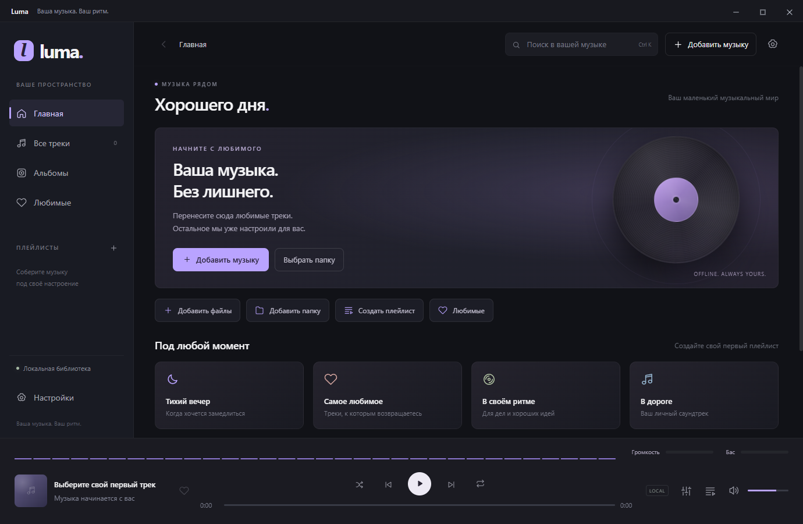
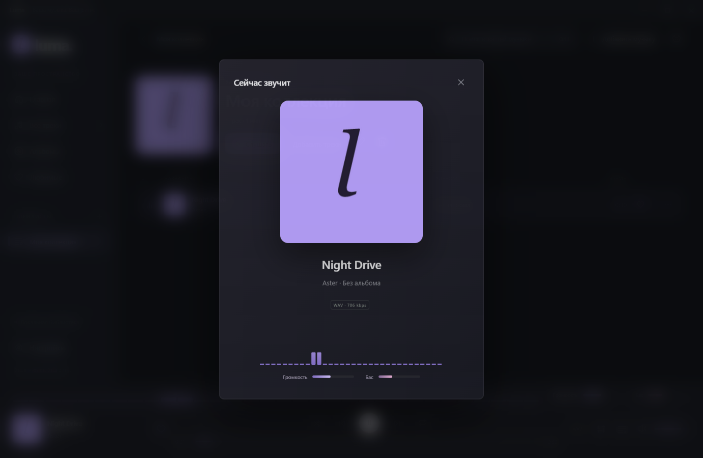

# Luma

Бесплатный локальный музыкальный центр для Windows с переключением оформления Windows / macOS и языков Русский / English.

[Скачать для Windows](https://github.com/replited-del/Luma/releases/latest) · [История версий](CHANGELOG.md) · [Сообщить об ошибке](https://github.com/replited-del/Luma/issues)



Free, open-source offline music player for Windows. Import your own music, organize playlists and albums, tune the 10-band equalizer, and enjoy a real-time spectrum with volume and bass meters. No account, subscription or ads. Available in Russian and English.

## Как пользоваться

1. Скачайте EXE из [GitHub Releases](https://github.com/replited-del/Luma/releases/latest). Закройте предыдущую версию Luma и запустите `Luma-1.2.0-Windows.exe`. Устанавливать Node.js или другие программы не нужно.
2. Нажмите **Добавить музыку** и выберите файлы или папку. Можно также перетащить их в окно.
3. Откройте **Все треки** и нажмите на название трека или кнопку воспроизведения рядом с ним. Одно нажатие запускает музыку, повторное на текущем треке переключает паузу.
4. Нажмите **+** возле плейлистов, создайте плейлист и добавьте музыку через **Добавить треки**.

Работает без аккаунта, интернета, подписки и рекламы. В комплекте нет коммерческой музыки: добавьте свою коллекцию.

## Оформление и язык

Нажмите шестерёнку в правом верхнем углу или **Настройки** в боковой панели.

- **Оформление окна → Windows**: обычные кнопки свернуть, развернуть / восстановить и закрыть справа сверху. Цветные кнопки скрыты. Этот стиль включён по умолчанию.
- **Оформление окна → macOS**: цветные кнопки слева, более скруглённые элементы и боковая панель с градиентом.
- **Язык интерфейса → Русский / English**: переводятся разделы, кнопки, настройки, диалоги импорта, меню треков и подсказки. Названия музыки и ваших плейлистов сохраняются.

Изменения применяются сразу, сохраняются после перезапуска и не прерывают музыку. Библиотека из версии 1.0 остаётся доступна.

В версии 1.1 увеличены шрифты и кнопки, добавлены быстрые действия на главной, кнопка назад и очистка поиска. Кнопки воспроизведения, любимых и меню треков постоянно доступны.

Поддерживаемые контейнеры: MP3, FLAC, WAV, M4A, AAC, OGG, OPUS, WEBM. Воспроизведение конкретного файла зависит от его кодека; защищённые DRM-файлы не поддерживаются. Основные проверки воспроизведения выполнены на WAV.

Функции: импорт папок с подпапками, чтение тегов и обложек, поиск, альбомы, любимые треки, плейлисты, история прослушивания, очередь, перемешивание, повтор, перемотка, громкость, 10-полосный эквалайзер с пресетами, компактные строки и отключение анимаций.

## Визуализация музыки

В версии 1.2 добавлен спектр частот и индикаторы громкости и баса в нижней панели и в окне текущего трека (нажмите обложку). Они измеряют реальный аудиосигнал после эквалайзера; бас — диапазон 30–250 Гц. Уровни отображаются по логарифмической шкале, это относительные цифровые уровни, а не громкость в помещении.

Отключение: **Настройки → Звук и удобство → Визуализация музыки**. Выбор сохраняется после перезапуска. На паузе индикаторы обнуляются; отключение визуализации не прерывает музыку. При скрытом окне отрисовка приостанавливается, а настройка «Меньше анимаций» снижает частоту обновления.



## Где хранится музыка

Файлы копируются в `%APPDATA%/luma-music/music`, обложки — в `covers`, библиотека и настройки — в `library.json`. Исходные файлы не изменяются и не удаляются. Повторные файлы определяются по содержимому.

«Убрать из библиотеки» удаляет запись из библиотеки и плейлистов. Импортированная копия сохраняется в папке приложения; исходник остаётся на месте. Для резервной копии закройте Luma и скопируйте всю папку `%APPDATA%/luma-music`.

## Клавиши

| Клавиши | Действие |
| --- | --- |
| Пробел | Воспроизведение / пауза |
| Ctrl K | Поиск |
| Ctrl O | Импорт |
| Ctrl → / Ctrl ← | Следующий / предыдущий трек |
| Enter на строке трека | Воспроизвести |
| Esc | Закрыть диалог или очередь |

## Разработка

Нужен Node.js 24 LTS и Windows 10/11 x64.

```powershell
npm ci
npm start
npm test
npm run build
```

Если версия npm не запускает установочные скрипты Electron автоматически, выполните `node node_modules/electron/install.js` после `npm ci`.

`npm test` запускает приложение с отдельной тестовой библиотекой, генерирует короткие аудиофайлы и проверяет импорт, дубликаты, повреждённые файлы, поиск, избранное, плейлисты, воспроизведение, перемотку, эквалайзер, очередь, сохранение настроек и перезапуск. Тестовые файлы находятся в соседней папке `work`.

Стек: Electron, JavaScript, HTML/CSS, Web Audio API, music-metadata. Интерфейс не использует удалённые шрифты, изображения или сетевые сервисы. Доступ renderer к Node.js отключён; файловые операции выполняются в главном процессе через ограниченный preload API.

Сборка Windows не подписана цифровым сертификатом.

Проверки запускаются на каждом изменении, в pull request и ежедневно через GitHub Actions. Workflow выпуска создаёт EXE для тегов `vX.Y.Z`; Dependabot предлагает обновления зависимостей. Подробнее — в [CONTRIBUTING.md](CONTRIBUTING.md).

Лицензия: [MIT](LICENSE).
